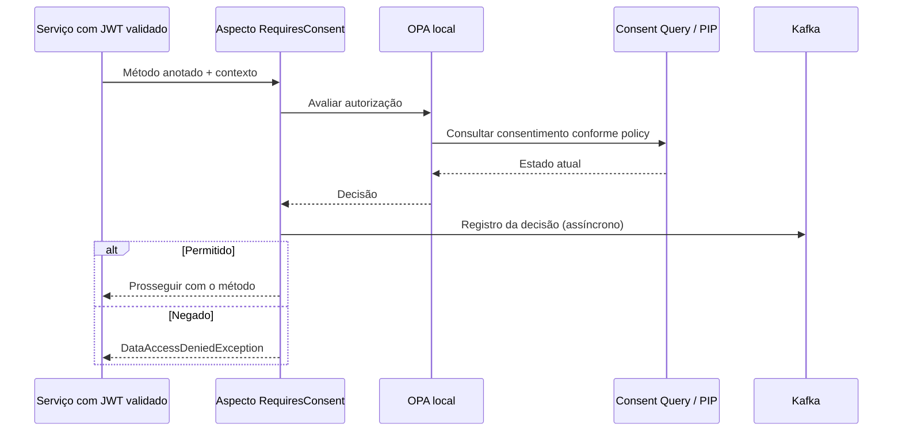

# TCC Security Starter

Biblioteca Spring Boot que concentra o **PEP (Policy Enforcement Point)** nos serviços do Consent & Audit Architecture: contexto de autorização, consulta ao OPA e publicação das decisões de auditoria.

Projeto pessoal de Renan Rohers, iniciado no TCC. [Visão geral](https://github.com/consent-audit-arch/infra#readme) · [Arquitetura](https://github.com/consent-audit-arch/infra/blob/main/docs/architecture.md)

## Fluxo



O starter implementa o enforcement no serviço. A lógica de política fica nos arquivos Rego; a consulta ao PIP depende da policy. A autenticação JWT e as credenciais M2M são configuradas pelas aplicações consumidoras.

## Instalação local

Java 21 e Maven:

```bash
mvn install
```

```xml
<dependency>
    <groupId>com.tcc</groupId>
    <artifactId>tcc-security-starter</artifactId>
    <version>0.0.1-SNAPSHOT</version>
</dependency>
```

## Uso

```java
@RequiresConsent(resource = "USER_PROFILE", action = "READ",
                 dataCategories = {"PERSONAL_DATA"})
```

A anotação é aplicada ao método protegido. O contexto aceita titular individual ou lote, categorias de dados, finalidade e identificador de correlação.

```yaml
tcc:
  security:
    enabled: true
    opa:
      enabled: true
      url: http://localhost:8181/v1/data/user/authz/decision
      timeout: 2s
    audit:
      kafka:
        enabled: true
spring:
  kafka:
    bootstrap-servers: localhost:9092
```

Ajuste o caminho OPA ao pacote da policy do serviço. Cabeçalhos padrão: `X-Purpose`, `X-Data-Subject-Id`, `X-Data-Subject-Ids`, `X-Data-Categories` e `X-Correlation-Id`.

## Componentes e limites

- `ConsentAuthorizationAspect`: intercepta métodos anotados e aplica a decisão.
- `OpaClient`: comunicação com o PDP; falhas de consulta são tratadas com negação.
- `KafkaAuditEventProducer`: publicação assíncrona em `ev-audit-authorizations`, com fallback para DLT.
- `TccSecurityProperties`: configuração em `tcc.security.*`; o controle pode ser desabilitado por configuração.

A decisão é registrada antes da execução do método. `ALLOWED` não comprova sucesso do processamento. O envio de auditoria não possui outbox durável local; falhas prolongadas podem comprometer a completude da trilha. Veja os [limites do protótipo](https://github.com/consent-audit-arch/infra/blob/main/docs/architecture.md#limites-e-evolução).
